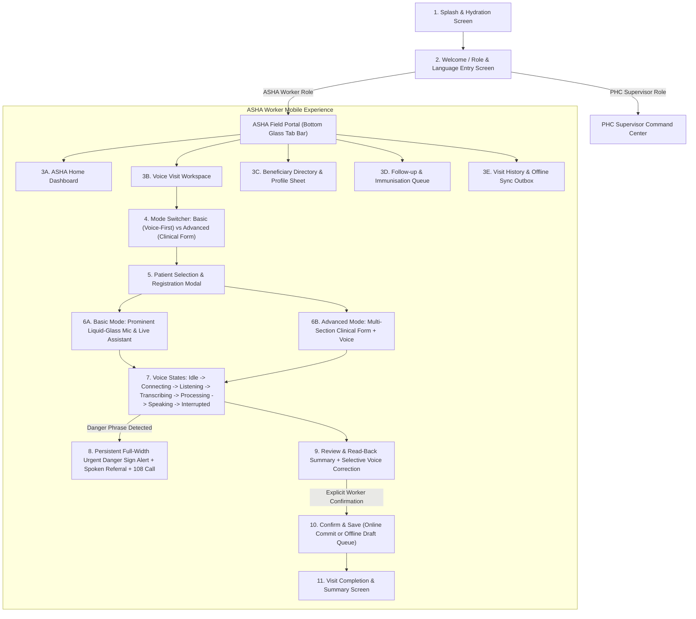

# Phase 2: Complete Mobile Screen Flow & UI/UX Architecture (`docs/SCREEN_FLOW.md`)

## 1. Screen-to-Screen Navigation Map

---

## 2. Detailed Screen & State Transitions

### 1. Splash & Hydration Screen
- Loads persisted language (`asha_selected_language`), active worker profile (`sakshya_active_profile`), experience mode (`sakshya_asha_experience_mode`), and offline drafts/beneficiaries from local storage (`AsyncStorage`), while pinging `GET /health` on the FastAPI backend.

### 2. Welcome / Role & Language Entry Screen
- **Language Picker**: One-tap native script pills + selector for all 10 Gnani Prisma languages (`hi-IN`, `kn-IN`, `ta-IN`, `te-IN`, `ml-IN`, `bn-IN`, `mr-IN`, `gu-IN`, `pa-IN`, `en-IN`, `indic-auto`).
- **Instant Synthetic Demo Roles**: One-tap sign-in as `Sunita Verma (ASHA - Hindi)`, `Padma Murthy (ASHA - Kannada)`, `Kalyani Natarajan (ASHA - Tamil)`, or `Dr. Sunita Rao (PHC Supervisor)`.
- **Staff Credentials Sign-In**: Email & password login against Supabase Auth when configured, plus Backend Endpoint Configuration modal for connecting physical phones to the backend host IP.

### 3. Mode Selection — Basic vs. Advanced
- **Persistent Glass Segmented Switcher** at the top of the Voice Visit Workspace:
  - **BASIC MODE (`basic`, Default)**: Streamlined voice assistant experience. Minimal visual clutter, single hero microphone orb, live transcript stream, and read-back review card.
  - **ADVANCED MODE (`advanced`)**: Organised mobile clinical cards with expandable/tabbed sections (Beneficiary & Visit Type, Maternal ANC/PNC or Newborn Care, Immunisation Completed/Due Badges, Danger Signs Status, Follow-up Actions, Spoken Read-Back & Applied Corrections Audit Log) where every field can be edited by touch OR corrected by voice.
- **Zero Data Loss on Mode Switch**: Switching between Basic and Advanced Mode preserves the active WebSocket voice session, `visitDraft`, `transcriptHistory`, `dangerAlerts`, and `correctionHistory`.

### 4. Patient Selection & Registration
- Search by name, `BEN-ID` (`BEN-1042`..`BEN-1056`), or village.
- Quick-select chips for recently visited beneficiaries.
- **Add New Patient Modal**: Registers a new patient (`POST /api/v1/beneficiaries` with offline fallback) and immediately selects them for the visit.
- **Ambiguous Beneficiary Disambiguation**: When the voice pipeline emits `clarification_required` (`reason: 'ambiguous_beneficiary'`), candidate cards appear for one-tap or spoken selection.

### 5. Voice Interaction & 6 Distinct Microphone States
The hero microphone button uses Apple-inspired Liquid Glass layering (`expo-blur` + translucent borders + solid high-contrast fallback) and respects OS `Reduce Motion`:
1. **Idle (`idle`)**: Subtle breathing glow in Clinical Teal (`#0F766E`), icon + label *"Tap to Start Voice Visit"*.
2. **Listening / Recording (`listening`, `transcribing`)**: Active pulsing ring in Emergency Crimson (`#DC2626`) + 16-band real-time audio level waveform + timer (`MM:SS`) + Hands-Free / Push-to-Talk toggle.
3. **Processing (`processing`, `connecting`, `reconnecting`)**: Animated orbital indicator in Amber (`#D97706`) / Sky (`#0284C7`) with clear text progress (*"Extracting visit fields & screening NHM danger signs..."*).
4. **Speaking / TTS Playback (`speaking`, `responding`)**: Sky Blue (`#0284C7`) / Indigo (`#4F46E5`) speaker state with **Pause / Resume** and immediate **Barge-In / Interrupt** button (*"Interrupt / Speak Now"*).
5. **Success / Completed (`completed`)**: Emerald (`#0D9488`) completion check badge.
6. **Error (`error`)**: Non-intrusive high-contrast alert state with specific error reason (permission denied, network drop, timeout) and one-tap **Retry / Reconnect** or **Offline Text/Draft Fallback**.

### 6. Barge-In & Audio Interruption Handling
- Speaking over TTS or tapping **Interrupt / Speak Now** immediately stops and unloads the active `expo-av` sound instance (`< 50ms`), increments `minPlayableTurnId`, discards any in-flight `tts_audio_chunk` packets from the cancelled turn (Zero-Stale-Audio rule), and sends `{"type": "barge_in"}` to the backend.

### 7. Urgent Danger Alert State
- When `danger_alert` arrives from the backend, a full-width, high-contrast crimson card (`#DC2626`) with white text (`> 7:1` contrast) pins to the top of the screen, triggers urgent haptic feedback (`expo-haptics`), displays the matched phrase, NHM guideline citation, and spoken referral instruction, provides a one-tap **Call 108 Ambulance** action (`tel:108`), and persists across corrections until explicitly acknowledged.

### 8. Read-Back, Selective Voice Correction & Confirm-Before-Save
- **Read-Back**: Before saving, the assistant reads back the extracted summary aloud via Gnani Timbre TTS.
- **Selective Voice Correction**: Tapping **Correct by Voice** on any field (or saying *"No, weight is 2.8 kilo"*) updates only the targeted field (`weight_kg`), preserves all other fields, logs the delta in `correctionHistory`, and flags `requiresReReadBack = true`.
- **Confirm-Before-Save Gate**: Nothing is committed to the visit register without explicit worker confirmation (spoken *"Yes, save"* or tapping **✓ ACCEPT & SAVE**).

### 9. Offline Drafts & Reconnect Sync
- Every draft update is persisted to local device storage (`AsyncStorage` outbox indexed by `draft_id` and `idempotency_key`).
- If the network drops after extraction, the worker can still review, edit, and confirm the visit offline; it queues with `sync_status: 'pending'` and automatically syncs when connectivity returns.

